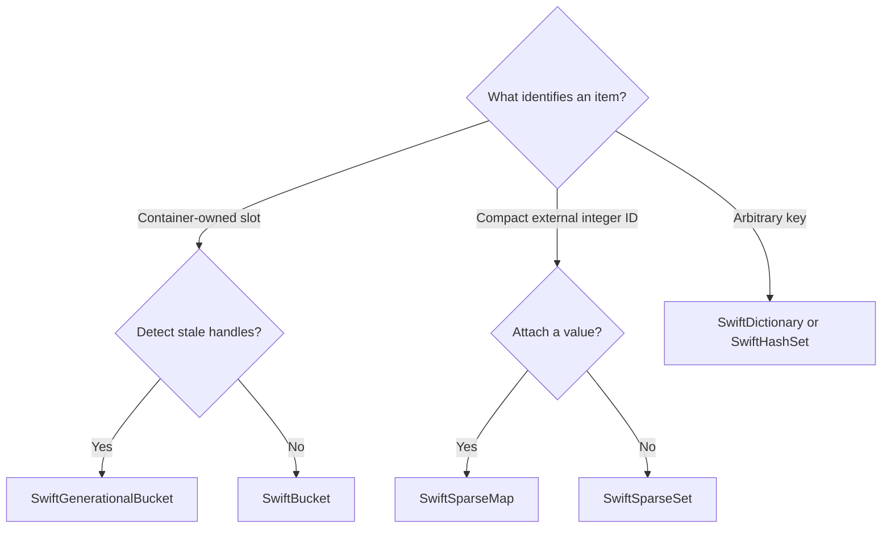

# Collections and clearing

Start with the ownership of IDs and the iteration pattern your workload needs.
The BCL remains a useful baseline; benchmark representative inputs before
choosing a specialized container.



## Core Collections

| Type                               | Primary Role                | Notes                                                                                                              |
| ---------------------------------- | --------------------------- | ------------------------------------------------------------------------------------------------------------------ |
| `SwiftList<T>`                     | Dynamic contiguous list     | Familiar list shape with SwiftCollections growth, span helpers, and explicit `SortInPlace` scratch-buffer sorting. |
| `SwiftQueue<T>`                    | Circular-buffer queue       | Suited for repeated enqueue/dequeue workloads.                                                                     |
| `SwiftStack<T>`                    | Array-backed stack          | Simple LIFO storage for low-overhead stack workloads.                                                              |
| `SwiftSortedList<T>`               | Sorted dynamic collection   | Keeps values ordered for search and ordered iteration.                                                             |
| `SwiftDictionary<TKey, TValue>`    | Hash table key/value lookup | Uses deterministic default string comparers when no comparer is supplied.                                          |
| `SwiftHashSet<T>`                  | Hash table set membership   | Uses deterministic default string comparers when no comparer is supplied.                                          |
| `SwiftBiDictionary<TLeft, TRight>` | Two-way lookup              | Maintains forward and reverse mappings.                                                                            |

`SwiftDictionary<TKey, TValue>` and `SwiftHashSet<T>` are the closest
alternatives to `Dictionary<TKey, TValue>` and `HashSet<T>`. They are not
intended as blind drop-in replacements. Benchmark the workload you care about,
especially when custom comparers, string keys, collision behavior, or
trim/resize patterns are important.

## Specialized Containers

| Use case                                                        | Better fit                                      | Why                                                                             |
| --------------------------------------------------------------- | ----------------------------------------------- | ------------------------------------------------------------------------------- |
| Store this object and give me a stable slot                     | `SwiftBucket<T>`                                | The container owns integer slot assignment and can reuse freed slots.           |
| Store this object and protect against stale references          | `SwiftGenerationalBucket<T>`                    | Handles include index plus generation, so reused slots invalidate old handles.  |
| I already have a compact non-negative int ID; track membership  | `SwiftSparseSet`                                | Sparse lookup plus dense key storage gives O(1) membership and dense iteration. |
| I already have a compact non-negative int ID; attach a value    | `SwiftSparseMap<T>`                             | Sparse lookup maps external IDs to densely stored values.                       |
| I need dense unique-value iteration with hash-backed membership | `SwiftPackedSet<T>`                             | Values are packed for iteration while membership remains hash-backed.           |
| IDs are arbitrary, huge, or widely sparse                       | `SwiftHashSet<int>` / `SwiftDictionary<int, T>` | Hash tables avoid allocating sparse arrays up to the highest ID.                |

Sparse containers are strongest when IDs are compact, non-negative, and
externally owned by a simulation, ECS, partition, or handle system. Their memory
usage scales with the highest stored ID, not only with the number of live IDs.

`SwiftSparseSet` and `SwiftSparseMap<T>` can copy dense keys into caller-owned
`SwiftList<int>` buffers, including sorted ascending export through
`CopySortedKeysTo(...)`. Use that path for deterministic per-frame scratch
ordering instead of building a persistent `SwiftSortedList<T>` solely to sort
transient keys.

## Clearing And Retained References

Core collections expose `Clear(bool clearRetainedReferences)` alongside their
existing parameterless clearing operations. Use the explicit option at an
ownership boundary when old backing slots must release their references:

```csharp
using SwiftCollections;

var scratch = new SwiftList<object>(1024);
scratch.Add(new object());
scratch.FastClear(); // Count becomes zero; the object remains in backing storage.
scratch.Clear(clearRetainedReferences: true); // Release retained references; keep capacity.
```

- `Clear()` and `Clear(false)` preserve the collection's normal clearing cost
  and behavior. They need not inspect retained slots outside the live range.
- `Clear(true)` also releases reference-containing payloads outside that range,
  including tails left by a previous `FastClear()` and smaller refill. Its cost
  can scale with retained capacity. It preserves capacity and normal collection
  policies such as comparers, sparse membership and notifications.
- `FastClear()` remains a count-only operation on the types that support it. It
  does not release stored references.

The explicit option is available on all core collection types. Bidirectional and
observable collections inherit it through their existing virtual clearing
behavior. Reference-containing structs receive the same cleanup as reference
types. Numeric-only payloads require no extra reference scan; `SwiftSparseSet`
therefore accepts the option without additional work. Full reference cleanup
does not promise to zero unused numeric storage.

`SwiftGenerationalBucket<T>.Clear()` invalidates live handles while preserving
generation history. Both clearing modes preserve subsequent handle allocation
when the cleared bucket is saved and restored. Fixed-size arrays, pools and
spatial indexes retain their separate clearing/lifecycle APIs.

## Make ordering an explicit contract

A deterministic string comparer does not make every key type deterministic.
Custom comparers and non-string keys retain their own hashing/equality
contracts. Hash-backed containers also do not promise a canonical sorted order.
When replay or output requires ascending integer IDs, copy and sort them through
`CopySortedKeysTo(...)` rather than depending on incidental storage order.

Continue with [Pools and observable collections](pools-and-observables.md) when
collection instances themselves are rented and reused.
