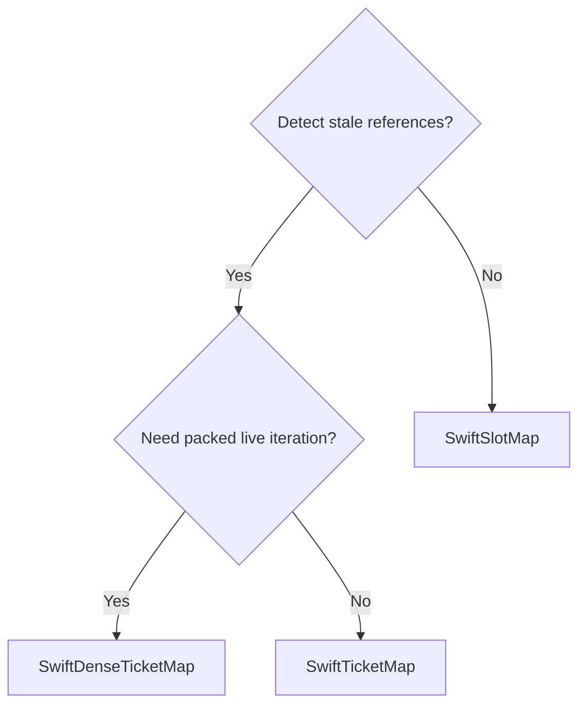
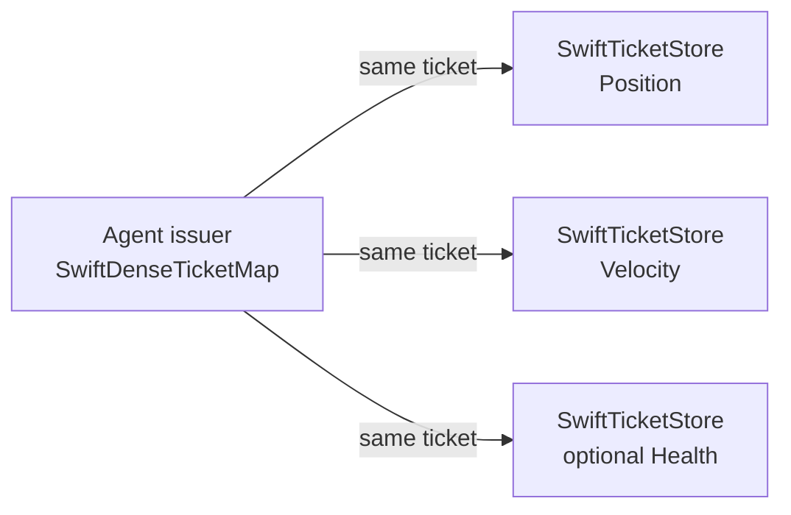

# Collections and clearing

Start with the ownership of IDs and the iteration pattern your workload needs.
The BCL remains a useful baseline; benchmark representative inputs before
choosing a specialized container.

When the collection should issue reusable identities, start with this choice.
The [comparison table](#specialized-containers) also covers externally owned IDs
and value-based membership. If another owner already issues tickets, start
with [optional components under one issuer](#optional-components-under-one-issuer).
On narrow screens, scroll the diagram horizontally.

<div class="sc-collection-choice" role="region" aria-label="Choose a collection that issues identities" tabindex="0">



</div>

## Core Collections

| Type                               | Primary Role                | Notes                                                                                                              |
| ---------------------------------- | --------------------------- | ------------------------------------------------------------------------------------------------------------------ |
| `SwiftList<T>`                     | Dynamic contiguous list     | Familiar list shape with SwiftCollections growth, span helpers, and explicit `SortInPlace` scratch-buffer sorting. |
| `SwiftQueue<T>`                    | Circular-buffer queue       | Suited for repeated enqueue/dequeue workloads.                                                                     |
| `SwiftStack<T>`                    | Array-backed stack          | Simple LIFO storage for low-overhead stack workloads.                                                              |
| `SwiftSortedList<T>`               | Sorted dynamic collection   | Keeps values ordered for search and ordered iteration.                                                             |
| `SwiftDictionary<TKey, TValue>`    | Hash table key/value lookup | Uses deterministic default string comparers when no comparer is supplied.                                          |
| `SwiftHashSet<T>`                  | Hash table set membership   | Uses deterministic default string comparers when no comparer is supplied.                                          |
| `SwiftBiDictionary<TLeft, TRight>` | Two-way lookup              | Maintains forward and reverse mappings.                                                                            |

`SwiftDictionary<TKey, TValue>` and `SwiftHashSet<T>` are the closest
alternatives to `Dictionary<TKey, TValue>` and `HashSet<T>`. They are not
intended as blind drop-in replacements. Benchmark the workload you care about,
especially when custom comparers, string keys, collision behavior, or
trim/resize patterns are important.

For deterministic work accounting, `SwiftHashSet<T>.EnumerationSlotCount` bounds
physical slots visited by a full enumeration, including removed entries.
`SwiftDictionary<TKey, TValue>.LookupProbeLimit` bounds entry probes for one key
lookup. Sample the bounds from the collection state used by the operation and
account for the key comparer's work separately.

## Specialized Containers

| Container                                                                                                                                      | Identity and stale-reference policy                                         | Lookup and iteration                                                                 | Storage follows                                                            |
| ---------------------------------------------------------------------------------------------------------------------------------------------- | --------------------------------------------------------------------------- | ------------------------------------------------------------------------------------ | -------------------------------------------------------------------------- |
| [SwiftSlotMap&lt;T&gt;](xref:SwiftCollections.SwiftSlotMap`1)                                                                                  | Issues reusable integer slots; callers discard removed indices              | Direct slot lookup; increasing slot order, scanning holes                            | Allocated slot range, including holes and spare capacity                   |
| [SwiftTicketMap&lt;T&gt;](xref:SwiftCollections.SwiftTicketMap`1)                                                                              | Issues index/generation tickets; finite generations wrap; default can match | Direct slot lookup plus generation check; increasing slot order, scanning holes      | Slot range, values in both live and unused entries, plus free stack        |
| [SwiftDenseTicketMap&lt;T&gt;](xref:SwiftCollections.SwiftDenseTicketMap`1)                                                                    | Issues index/generation tickets; default is invalid; terminal slots retire  | Slot-to-dense lookup plus generation check; packed live iteration, swap-back removal | Dense value/ID capacity plus issued-slot metadata, including retired slots |
| [SwiftTicketStore&lt;T&gt;](xref:SwiftCollections.SwiftTicketStore`1) | Accepts external tickets; exact local generation check; no issuer liveness check | Sparse-to-dense lookup; packed values and swap-back; one entry per index | Highest ticket index plus independent dense capacity |
| [SwiftSparseSet](xref:SwiftCollections.SwiftSparseSet) / [SwiftSparseMap&lt;T&gt;](xref:SwiftCollections.SwiftSparseMap`1)                     | Accept your non-negative integer IDs; no generation checks                  | Sparse-to-dense lookup; packed iteration, swap-back removal                          | Highest ID plus dense capacity                                             |
| [SwiftPackedSet&lt;T&gt;](xref:SwiftCollections.SwiftPackedSet`1)                                                                              | Uses value equality; equal duplicates rejected                              | Hash-backed membership; packed iteration, swap-back removal                          | Dense capacity plus hash table                                             |
| [SwiftDictionary&lt;TKey, TValue&gt;](xref:SwiftCollections.SwiftDictionary`2) / [SwiftHashSet&lt;T&gt;](xref:SwiftCollections.SwiftHashSet`1) | Accept arbitrary keys/values under their comparer                           | Hash lookup; no canonical sorted iteration order                                     | Hash table capacity, rather than highest integer key                       |

Slot and sparse lookup is O(1); dense iteration visits Count live entries.
Hash-table lookup is expected O(1), with comparer and collision costs. In the
owned slot/ticket maps, Add is amortized O(1); sparse growth also depends on the
highest ID. Reserve outside a hot loop when allocations are unacceptable. Dense
removal moves a value, which costs more for a large struct. A slot-backed map
avoids that move and the extra lookup hop; the dense map avoids scanning holes
during iteration. Benchmark the actual churn, payload size and
lookup-to-iteration ratio rather than assuming one layout always wins.

Sparse containers are strongest when IDs are compact and externally owned. Their
lookup storage grows to the highest ID, so use a dictionary or hash set for huge
or widely scattered IDs. Use `SwiftList<T>` when ordinary dense indices are
sufficient and no stable identity is needed.

## Who issues the identity?

Slot and ticket owners issue an identity when you call `Add`. Lookup and removal
take that identity back. `SwiftSparseMap<T>.Add(id, value)` instead accepts an
ID issued elsewhere; `TryAdd` reports whether that ID was absent. These are
different ownership models even when the stored payloads look alike.

Tickets identify allocations, while packed-set membership identifies equal
values. Dense ticket maps accept duplicate, null, default and mutable payloads
without hashing them. `SwiftPackedSet<T>` requires non-null unique values whose
equality/hash identity stays stable while stored. Remove a value before changing
fields used for set membership, then re-add it; writing its exposed Dense array
bypasses the lookup and can corrupt membership.

### Stable slots under your ownership

Use `SwiftSlotMap<T>` when items need stable indices while registered and the
owner can discard every saved index when removing an item. Other live items keep
their indices; removal leaves a reusable slot rather than shifting them.

```csharp
using SwiftCollections;

var registrations = new SwiftSlotMap<string>();
int firstSlot = registrations.Add("first");
registrations.TryRemoveAt(firstSlot);

int replacementSlot = registrations.Add("replacement");
bool sameSlot = firstSlot == replacementSlot; // true: the freed slot was reused.
bool found = registrations.TryGetValue(firstSlot, out string value);
// found is true and value is "replacement". The integer cannot detect staleness.
```

This fits a tightly owned registry whose removal path also clears its callers'
stored IDs. `InsertAt` can explicitly choose or replace a slot, but adds no
generation validation. Reinserting a freed slot removes it from free ownership
in constant time and preserves the reuse order of other freed slots. Use a
sparse map when attaching values to existing external IDs is the main job.

### A ticket for one allocation

Use `SwiftTicketMap<T>` when a saved identity can outlive removal, such as a
queued command or delayed lookup. Keep the ticket returned by `Add` and pass it
back to `TryGet`, `Remove`, or `IsValid`:

```csharp
using SwiftCollections;

var actors = new SwiftTicketMap<string>();
SwiftTicket oldTicket = actors.Add("first");
actors.Remove(oldTicket);

SwiftTicket currentTicket = actors.Add("replacement");
bool oldFound = actors.TryGet(oldTicket, out _); // false: generation changed.
bool currentFound = actors.TryGet(currentTicket, out string actor);
// currentFound is true and actor is "replacement".
```

A ticket identifies one allocation: its index chooses the slot and its
generation distinguishes allocations of that slot. Preserve both fields when
storing a ticket. Tickets belong to their originating collection; they carry no
collection identity and are not globally unique IDs. Generations are finite
`uint` counters, so this is not an unlimited uniqueness guarantee.
`SwiftTicketMap<T>` starts fresh slots at generation zero:
`default(SwiftTicket)` can match the first live allocation. Removal/Clear
advances generations, which can wrap back to an older value. Do not use a
default ticket as an absence marker without a separate presence flag. This
differs from the dense owner's rules below. Slot-backed maps do not compact live
values on removal; enumeration scans holes below the slot high-water boundary
instead of visiting only live values.

### Tickets with dense iteration

Use `SwiftDenseTicketMap<T>` when you own registration lifetimes and frequently
iterate live values after churn. Values can be mutable, duplicate, null or
default; membership depends on tickets rather than value equality. Removal moves
the last value into the gap and repairs its lookup, preserving surviving
tickets:

```csharp
var registrations = new SwiftDenseTicketMap<int>();
SwiftTicket removed = registrations.Add(10);
SwiftTicket survivor = registrations.Add(20);
registrations.Remove(removed);
registrations.GetRef(survivor) = 25; // Still identifies the moved value.
bool staleFound = registrations.TryGet(removed, out _); // false
SwiftTicket current = registrations.GetTicketAt(0); // survivor
```

Concrete enumeration and `Values` visit the live dense prefix. Dense positions
and borrowed refs/spans must be reacquired after structural changes; stable
tickets do not imply stable addresses or insertion order. Lookup adds a mapping
hop and swap-back adds removal work, so the slot-backed ticket map remains a
useful choice for lookup-heavy workloads.

This owner starts generations at one, rejects default tickets, and retires a
slot at the terminal generation. `Clear` preserves generation history and
existing free order; newly freed slots follow increasing old dense order and are
reused from the resulting LIFO. Capacity is retained. The getter-only `State`
snapshots dense order, all issued generations and free order; construct a new
owner from it to restore. Snapshots copy arrays shallowly, and reference payload
objects remain shared. Rewinding state can revive numeric tickets, so discard
handles from abandoned future states. Tickets carry no owner identity.

`DenseCapacity` counts value storage; `SlotCapacity` also includes retired and
unissued storage. `EnsureCapacity` reserves for a live population accounting for
currently retired slots. Later retirement can consume that budget and require
growth without increasing the peak live count.

### Delayed work and dense agent updates

For a tool registry, keep a registration ticket with each queued command.
Resolve that ticket when the command executes. This scenario follows the
registration churn tests: removing registration 202 moves 303 in dense storage,
then a new registration reuses the freed slot with a new generation.

```csharp
var registrations = new SwiftDenseTicketMap<int>();
registrations.Add(101);
SwiftTicket queued = registrations.Add(202);
SwiftTicket moved = registrations.Add(303);
registrations.Remove(queued);
SwiftTicket replacement = registrations.Add(404);

bool applyOldCommand = registrations.TryGet(queued, out _); // false
int survivor = registrations.GetRef(moved); // 303, despite the dense move
int next = registrations.GetRef(replacement); // 404, ticket (1, 2)
// Dense values are now [101, 303, 404].
```

The ticket protects one registration's lifetime. A physics body, navigation
request and editor selection can each have their own owner because they start
and end at different times. Store an application's shared agent ID in each
record if those registrations need to refer back to the same agent. Do not pass
a ticket issued by one map to another: matching numeric fields can alias.

An **entity** is an identity for a simulated agent. A **component** is one kind
of data attached to it, such as position or health; a **component store** holds
that kind of data for many entities. A single combined agent record is enough
when those values share a lifetime and are commonly updated together. For
example, the agent-tick tests update a packed population through `Values`:

```csharp
using System;
using SwiftCollections;

var agents = new SwiftDenseTicketMap<(int Id, int Position, int Velocity)>();
agents.Add((101, 0, 2));
SwiftTicket removed = agents.Add((202, 10, -1));
agents.Add((303, 100, 3));
Advance(agents);
agents.Remove(removed);
agents.Add((404, -5, 4));
Advance(agents);
Advance(agents);
// Dense IDs: [101, 303, 404]; positions: [6, 109, 3].

static void Advance(SwiftDenseTicketMap<(int Id, int Position, int Velocity)> agents)
{
    Span<(int Id, int Position, int Velocity)> values = agents.Values;
    for (int i = 0; i < values.Length; i++)
        values[i].Position += values[i].Velocity;
}
```

Apply additions and removals between these loops, then reacquire the span. The
same initial state and ordered mutations produce the same dense order; that
order is not sorted, insertion-stable, or independent of mutation order.

### Optional components under one issuer

Separate optional components become useful when, for example, only some agents
have health and health can be removed without destroying the agent. Those stores
need the same externally issued identity. Independently issuing a ticket from
each dense map does not establish that relationship.

Use `SwiftTicketStore<T>` for these external-ticket values. For example,
`SwiftDenseTicketMap<Agent>` can issue one agent ticket while independent
`SwiftTicketStore<Position>`, `SwiftTicketStore<Velocity>` and
`SwiftTicketStore<Health>` instances attach optional records. Iterate Position's
Values and use GetTicketAt to look up Velocity; separate dense stores can have
different orders and must not be zipped by position.


<div class="sc-collection-choice" role="region" aria-label="One issuer with independent component stores" tabindex="0">



</div>

The issuer owns agent lifetimes. Each store owns only its attached records;
removing Health leaves the agent, Position and Velocity alive. The following
integer example deliberately attaches Velocity in another order:

```csharp
using System;
using SwiftCollections;

var agents = new SwiftDenseTicketMap<int>();
SwiftTicket a = agents.Add(101);
SwiftTicket b = agents.Add(202);
SwiftTicket c = agents.Add(303);
var positions = new SwiftTicketStore<int>();
positions.Add(a, 0);
positions.Add(b, 10);
positions.Add(c, 100);
var velocities = new SwiftTicketStore<int>();
velocities.Add(c, 3);
velocities.Add(a, 2);
velocities.Add(b, -1);
Advance(positions, velocities); // Positions [2, 9, 103], joined by ticket.

positions.Remove(b); // Remove components before ending their agent lifetime.
velocities.Remove(b);
agents.Remove(b);
SwiftTicket d = agents.Add(404); // (1, 2); b was (1, 1).
positions.Add(d, -5);
velocities.Add(d, 4);
bool removedReplacement = positions.Remove(b); // false: the old key is stale.
Advance(positions, velocities);
Advance(positions, velocities);
// Position tickets [a, c, d], values [6, 109, 3].
// Velocity tickets [c, a, d], values [3, 2, 4].

static void Advance(SwiftTicketStore<int> positions, SwiftTicketStore<int> velocities)
{
    Span<int> values = positions.Values;
    for (int i = 0; i < values.Length; i++)
        if (velocities.TryGet(positions.GetTicketAt(i), out int velocity))
            values[i] += velocity;
}
```

Reserve both stores before a hot loop when growth is undesirable. Perform
structural changes between loops, reacquire borrowed spans, and validate the
issuer at the caller's attachment boundary. Passing only ticket.Index to a
SwiftSparseMap would discard generation checks; using independent issuing maps
for Position and Velocity would create independent identities.

A store accepts every generation, including a legacy issuer's `(0,0)`, and keeps
one entry per index. TryAdd returns false for both exact duplicates and another
generation at an occupied index; it never replaces an entry. ContainsKey means
only that the exact ticket is stored locally. Validate against the issuer at
attachment, remove components before issuer reuse, and restore issuer plus stores
from one coherent snapshot boundary. Removing Health leaves the agent and other
stores alive; reattaching Health uses the same agent ticket. Delayed work for a
particular Health incarnation needs an application revision as well.

State snapshots copy the three logical arrays in dense order, sharing referenced
payload objects. Restoration validates and copies those arrays, rebuilding
lookup without consulting an issuer. Sparse storage follows the highest ticket
index, so use compact IDs and reserve sparse/dense capacity independently.
Structural mutation invalidates borrows, enumeration and dense positions;
failed key operations and no-op reservations preserve them. Store operations
never advance issuer generations or automatically remove orphaned components.
These collections provide storage primitives, not an ECS scheduler, global
identity domain or aggregate transaction.


With sparse capacity S and dense capacity D, the current three arrays carry
`4*S + 8*D + managedWidth(T)*D` bytes, before object/array headers and referenced
payload objects. Attaching 4,096 components across 16,384 possible indices can
keep D at 4,096. Filling 16,384 entries and removing down to 4,096 retains D at
16,384 instead. Remove and Clear retain both capacities; budget sparse storage
for the highest index and dense storage for the peak live population.

### Borrowed storage is temporary

Keep tickets or IDs across operations, not dense positions or borrowed
addresses. For the dense ticket map and external ticket store, reacquire `GetRef`, `Values` and
`GetTicketAt` positions after structural mutation; a moved value can occupy
another value's former address. Actual `EnsureCapacity` growth also invalidates
borrows and enumeration; a no-op reservation preserves them. Writes through a
ref/span change payloads without advancing the enumerator version.

Slot-backed values are not moved by ordinary removal of another slot, but
removal, reuse, Clear, resize and restore can invalidate the relevant storage or
identity. Sparse-map spans also need reacquiring after structural changes, and
key arrays must never be modified directly. Packed-set spans are read-only
views; referenced objects still must preserve equality/hash identity. No
collection's stable handle promises a stable memory address or thread safety.
Synchronize owner access externally and avoid structural mutation while
enumerating.

For snapshots, validation, ownership and closed AOT serializer registration, see
[dense-ticket persistence](serialization-and-diagnostics.md#preserve-dense-ticket-identity-and-reuse)
and [external ticket persistence](serialization-and-diagnostics.md#persist-externally-issued-ticket-entries).
The dense owner validates a complete live/free/retired partition and
reconstructs capacity from logical state. Existing slot/ticket owner state
constructors have more permissive contracts; do not treat them as equivalent
validators.

### Values attached to existing IDs

Use `SwiftSparseMap<T>` when another system already owns compact integer IDs:

```csharp
using SwiftCollections;

int actorId = 42; // Issued by the owning system.
var labels = new SwiftSparseMap<string>();
labels.Add(actorId, "player");
bool found = labels.TryGetValue(actorId, out string label);
// found is true and label is "player"; the map did not issue actorId.
```

Passing only `ticket.Index` as the ID discards its generation. If an agent dies
and that slot is reused, stale component data can be mistaken for the new
allocation unless the application removes it and validates the full identity. A
sparse map is not a generation-aware component store.

Choose `SwiftSparseSet` for membership without a payload. If IDs can be very
large or widely scattered, use a hash-based collection instead of allocating
sparse lookup storage up to the highest ID. Choose `SwiftList<T>` when indices
need no stability across structural edits, or `SwiftPackedSet<T>` when dense
unique-value iteration and membership matter more than assigned slots.

`SwiftSparseSet` and `SwiftSparseMap<T>` can copy dense keys into caller-owned
`SwiftList<int>` buffers, including sorted ascending export through
`CopySortedKeysTo(...)`. Use that path for deterministic per-frame scratch
ordering instead of building a persistent `SwiftSortedList<T>` solely to sort
transient keys.

## Unique insertion in sorted lists

Use `SwiftSortedList<T>.TryAddUnique(item)` when values must stay ordered and
the list should reject a value that compares equal to an existing value.
`Add(item)` allows duplicates. A rejected insertion leaves the list and active
enumerators valid.

## Clearing And Retained References

Many core collections expose `Clear(bool clearRetainedReferences)` alongside
their existing parameterless clearing operations. Use the explicit option at an
ownership boundary when old backing slots must release their references:

```csharp
using SwiftCollections;

var scratch = new SwiftList<object>(1024);
scratch.Add(new object());
scratch.FastClear(); // Count becomes zero; the object remains in backing storage.
scratch.Clear(clearRetainedReferences: true); // Release retained references; keep capacity.
```

- `Clear()` and `Clear(false)` preserve the collection's normal clearing cost
  and behavior. They need not inspect retained slots outside the live range.
- `Clear(true)` also releases reference-containing payloads outside that range,
  including tails left by a previous `FastClear()` and smaller refill. Its cost
  can scale with retained capacity. It preserves capacity and normal collection
  policies such as comparers, sparse membership and notifications.
- `FastClear()` remains a count-only operation on the types that support it. It
  does not release stored references.

`SwiftDenseTicketMap<T>` always releases discarded references in Remove and
Clear and exposes no writable spare range or FastClear path, so it needs only
parameterless Clear. The other core collection types provide the explicit
option. Bidirectional and observable collections inherit it through their
existing virtual clearing behavior. Reference-containing structs receive the
same cleanup as reference types. Numeric-only payloads require no extra
reference scan; `SwiftSparseSet` therefore accepts the option without additional
work. Full reference cleanup does not promise to zero unused numeric storage.

`SwiftTicketMap<T>.Clear()` invalidates live tickets while preserving generation
history. Both clearing modes preserve subsequent ticket allocation when the
cleared map is saved and restored. Fixed-size arrays, pools and spatial indexes
retain their separate clearing/lifecycle APIs.

## Make ordering an explicit contract

A deterministic string comparer does not make every key type deterministic.
Custom comparers and non-string keys retain their own hashing/equality
contracts. Hash-backed containers also do not promise a canonical sorted order.
When replay or output requires ascending integer IDs, copy and sort them through
`CopySortedKeysTo(...)` rather than depending on incidental storage order.

Continue with [Pools and observable collections](pools-and-observables.md) when
collection instances themselves are rented and reused.
